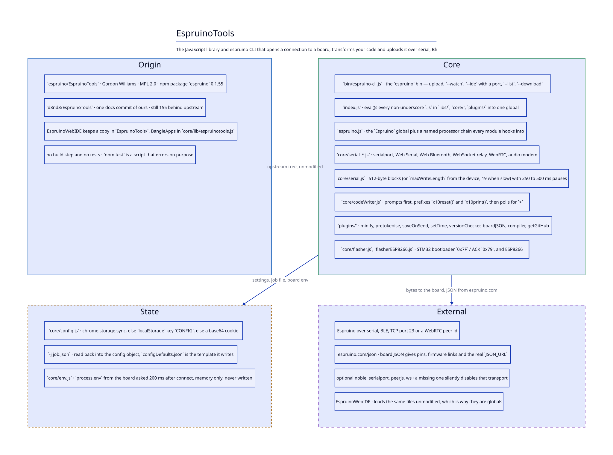

# EspruinoTools

The library behind every Espruino upload: open a connection to a board, transform the code, and push it over serial, Bluetooth or TCP — also shipped as the `espruino` command-line tool.

Read it left to right:

- **This fork is a mirror with only this document added.** `d3nd3/EspruinoTools` is 155 commits behind `espruino/EspruinoTools` and carries no source changes of its own. The same code is vendored twice — EspruinoWebIDE keeps a full copy in `EspruinoTools/`, BangleApps keeps one file in `core/lib/espruinotools.js` — so a fix here reaches neither until somebody re-copies it.
- **There is no module system to follow.** `index.js` reads `libs/`, `core/` and `plugins/` in directory order and `eval()`s every `.js` whose name does not start with `_` into one global scope, after shimming jQuery, `navigator` and `document` so browser code runs under node. Every file therefore just calls `Espruino.addProcessor(...)` on the `espruino.js` bus, and load order is file order.
- **An upload is a conversation, not a write.** `core/codeWriter.js` first insists on a prompt (sending Ctrl-C if there is none), prefixes `\x10reset()` when `RESET_BEFORE_SEND` is on and `\x10print()` to consume the prompt, then `core/serial.js` pushes 512-byte blocks — or the device's `maxWriteLength`, 19 bytes when slow — pausing 250 ms after Ctrl-C, `reset()`, `load()` and `Modules.addCached`, and 500 ms after every `Storage.write`.
- **Success is guessed from the terminal text.** After sending, it polls the terminal's current line for a leading `>` every 100 ms, for up to 5 s with save-on-send and 2 s without; if the prompt never appears it sends `\x03\x03echo(1)` to recover. There is no checksum or length reply.
- **The board describes itself at runtime.** `core/env.js` asks for `process.env` 200 ms after connecting, then `plugins/boardJSON.js` fetches `espruino.com/json/<BOARD>.json` (or the board's own `JSON_URL`) for pins and firmware links. Nothing is cached to disk, so an offline machine loses code completion and the firmware-update offer.
- **Settings live wherever the host has storage.** `core/config.js` tries `chrome.storage.sync`, then `localStorage` under the key `CONFIG`, then a base64 cookie; under node the CLI loads a job file with `-j` and `configDefaults.json` is only the template it writes when you ask for a new one.

Diagram source: [`docs/system.d2`](docs/system.d2) · renderer: [`scripts/render-diagram.sh`](scripts/render-diagram.sh).
